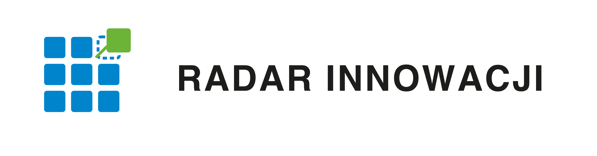
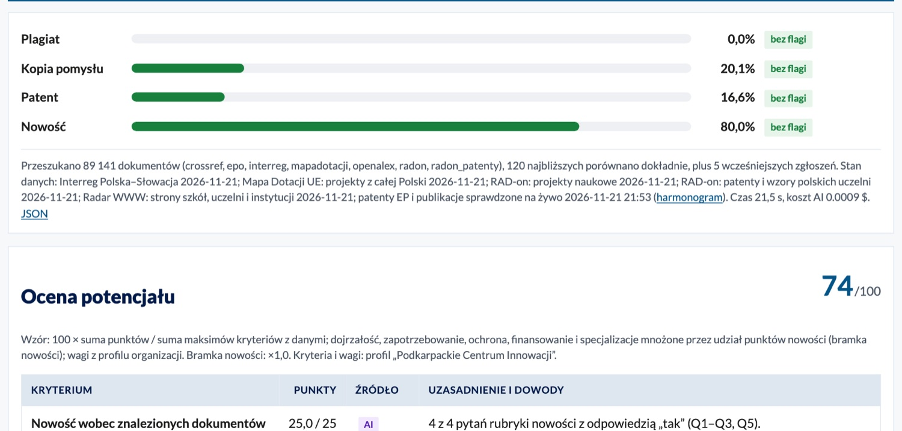
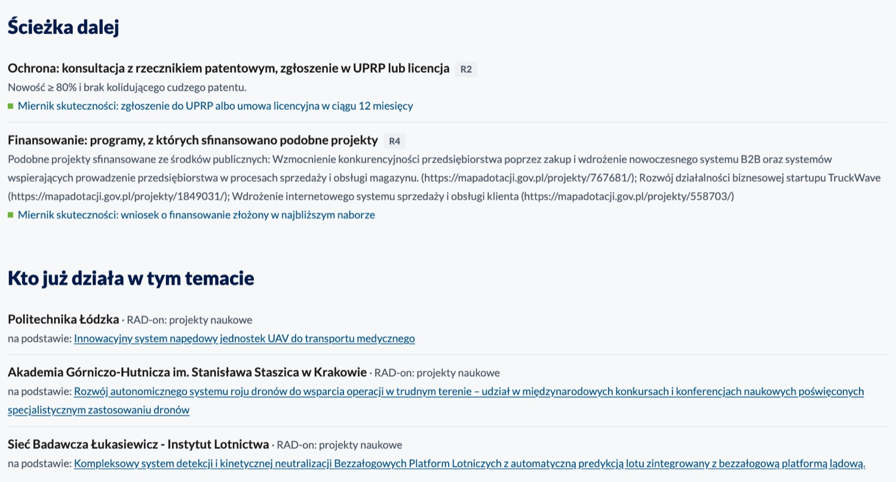
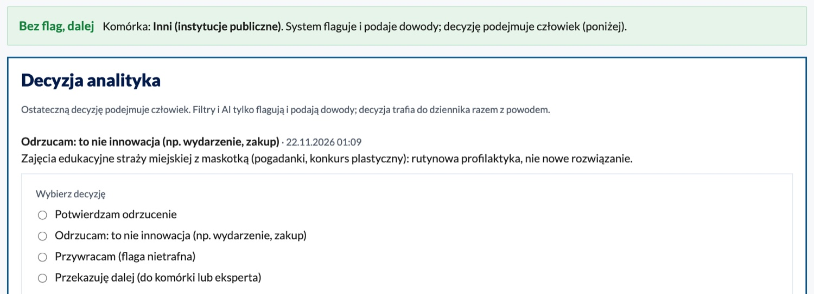
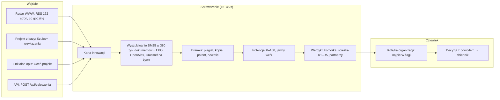

<a id="readme-top"></a>

<!-- ODZNAKI -->
[![Demo][demo-shield]][demo-url]
[![Licencja EUPL-1.2][licencja-shield]][licencja-url]
[![Python 3.12+][python-shield]][python-url]
[![Testy][testy-shield]](testy)
[![HackNation 2026][hn-shield]](#podziękowania)

<!-- LOGO I NAGŁÓWEK -->
<br />
<div align="center">
  <a href="https://radar-innowacji.skroban.tech/">
    
  </a>

  <h3 align="center">Radar Innowacji</h3>

  <p align="center">
    Sam znajduje ukryte innowacje w szkołach, uczelniach i samorządach, ocenia je według jawnych kryteriów
    z dowodem przy każdej liczbie i kieruje do właściwych odbiorców. Decyzję podejmuje człowiek.
    <br />
    <a href="docs/SPECYFIKACJA.md"><strong>Specyfikacja »</strong></a>
    &nbsp;·&nbsp;
    <a href="docs/ARCHITEKTURA.md"><strong>Architektura i schematy »</strong></a>
    <br />
    <br />
    <a href="https://radar-innowacji.skroban.tech/">Działające demo</a>
    &middot;
    <a href="docs/prezentacja/radar-innowacji-film.mp4">Film (2:33)</a>
    &middot;
    <a href="docs/prezentacja/radar-innowacji.pdf">Prezentacja PDF</a>
    &middot;
    <a href="https://radar-innowacji.skroban.tech/docs">API (OpenAPI)</a>
  </p>
</div>

<!-- SPIS TREŚCI -->
<details>
  <summary>Spis treści</summary>
  <ol>
    <li><a href="#o-projekcie">O projekcie</a>
      <ul>
        <li><a href="#dla-jurorów-scenariusz-ae-w-3-minuty">Dla jurorów: scenariusz a–e w 3 minuty</a></li>
        <li><a href="#problem">Problem</a></li>
        <li><a href="#rozwiązanie">Rozwiązanie</a></li>
        <li><a href="#zbudowane-z">Zbudowane z</a></li>
      </ul>
    </li>
    <li><a href="#jak-to-działa">Jak to działa</a></li>
    <li><a href="#dla-kogo">Dla kogo</a></li>
    <li><a href="#dane-aktualność-i-opóźnienia">Dane: aktualność i opóźnienia</a></li>
    <li><a href="#ocena-cztery-filtry-i-potencjał">Ocena: cztery filtry i potencjał</a></li>
    <li><a href="#ścieżki-dalej-i-mierniki-skuteczności">Ścieżki dalej i mierniki skuteczności</a></li>
    <li><a href="#miary-jakości">Miary jakości</a></li>
    <li><a href="#pierwsze-kroki">Pierwsze kroki</a>
      <ul>
        <li><a href="#wymagania">Wymagania</a></li>
        <li><a href="#instalacja">Instalacja</a></li>
        <li><a href="#wdrożenie">Wdrożenie</a></li>
      </ul>
    </li>
    <li><a href="#użycie">Użycie</a></li>
    <li><a href="#struktura-repozytorium">Struktura repozytorium</a></li>
    <li><a href="#ograniczenia">Ograniczenia</a></li>
    <li><a href="#plan-rozwoju">Plan rozwoju</a></li>
    <li><a href="#współtworzenie">Współtworzenie</a></li>
    <li><a href="#licencja">Licencja</a></li>
    <li><a href="#kontakt">Kontakt</a></li>
    <li><a href="#podziękowania">Podziękowania</a></li>
  </ol>
</details>


<!-- O PROJEKCIE -->
## O projekcie

[![Strona główna radaru: lejek wykryć i ostatnio wykryte innowacje][zrzut-start]](https://radar-innowacji.skroban.tech/)

Radar Innowacji to rozwiązanie zadania „Radar innowacji” Podkarpackiego Centrum Innowacji (HackNation 2026).
Radar **nie jest platformą do zgłaszania pomysłów**: co godzinę sam czyta strony szkół, uczelni i urzędów, a projekty,
patenty i publikacje porównuje z ponad 380 tys. dokumentów z publicznych baz. Każdy wynik ma procent, pasmo
(zielone, żółte, czerwone) i link do dokumentu, który jest dowodem. PCI jest pierwszym profilem organizacji;
kolejna organizacja to jeden plik JSON z komórkami, ścieżkami i wagami, bez zmian w kodzie.

### Dla jurorów: scenariusz a–e w 3 minuty

| Materiał | Link |
|---|---|
| Działające demo | https://radar-innowacji.skroban.tech/ |
| Film (2:33, z lektorem i napisami) | [docs/prezentacja/radar-innowacji-film.mp4](docs/prezentacja/radar-innowacji-film.mp4) |
| Prezentacja PDF (10 slajdów) | [docs/prezentacja/radar-innowacji.pdf](docs/prezentacja/radar-innowacji.pdf) |
| Specyfikacja (kryteria, reguły, dane, opóźnienia, ścieżki) | [docs/SPECYFIKACJA.md](docs/SPECYFIKACJA.md) |
| Architektura i schematy | [docs/ARCHITEKTURA.md](docs/ARCHITEKTURA.md) |
| API (OpenAPI) | https://radar-innowacji.skroban.tech/docs |

Dwa przypadki z zadania, wszystko do kliknięcia na żywej stronie:

| Krok scenariusza | Przypadek 1: radar sam wykrył innowację | Przypadek 2: firma szuka rozwiązania i zleca ocenę |
|---|---|---|
| a) wykrycie albo wprowadzenie | wpis w aktualnościach technikum w Trzcianie, znaleziony bez zgłoszenia → [karta 7](https://radar-innowacji.skroban.tech/karta/7) | „Szukam rozwiązania”: [drony autonomiczne ładowanie](https://radar-innowacji.skroban.tech/szukaj?q=drony+autonomiczne+%C5%82adowanie) → „Oceń ten projekt” przy systemie AirNest |
| b) kluczowe informacje | [karta innowacji](https://radar-innowacji.skroban.tech/karta/7): opis, instytucja, cytat ze źródła, etap koncepcji, TRL 1–3, specjalizacja ICT, wiarygodność 2/5 | [karta 18](https://radar-innowacji.skroban.tech/karta/18): status wdrożenia z rejestru, TRL 6–9, wiarygodność 3/5 |
| c) ocena potencjału | 4 filtry bez flag (plagiat 0%, kopia 20%, patent 17%, nowość 80%), [potencjał 74/100](https://radar-innowacji.skroban.tech/karta/7#potencjal) | 4 filtry bez flag, [potencjał 87/100](https://radar-innowacji.skroban.tech/karta/18#potencjal), sprawdzenie w 17 s |
| d) odbiorcy, partnerzy, ścieżki | komórka PCI: młodzi innowatorzy 16–30; ścieżka R2 (ochrona), bo nowość ≥ 80% i brak kolidującego patentu; R4 na tej karcie to słabe dopasowanie (patrz [Ograniczenia](#ograniczenia)) | partnerzy z podobnymi projektami: Politechnika Łódzka, AGH, Łukasiewicz – Instytut Lotnictwa; R2 i R4 |
| e) uzasadnienie i mierniki | miernik R2: zgłoszenie do UPRP albo umowa licencyjna w 12 miesięcy; decyzja analityka z powodem w dzienniku | mierniki R2 i R4: zgłoszenie albo licencja w 12 miesięcy, wniosek o finansowanie w najbliższym naborze |

Uczciwy test: [kolejka PCI](https://radar-innowacji.skroban.tech/o/pci/kolejka?wejscie=radar) pokazuje, co bramka odrzuciła automatycznie,
[karta 10](https://radar-innowacji.skroban.tech/karta/10) to błąd AI (zajęcia z maskotką) poprawiony jedną decyzją analityka,
a [miary](https://radar-innowacji.skroban.tech/miary) podają wyniki zestawu kontrolnego.

<table>
  <tr>
    <td></td>
    <td></td>
    <td></td>
  </tr>
  <tr>
    <td align="center">Filtry z dowodami (karta 7)</td>
    <td align="center">Ścieżka i partnerzy (karta 18)</td>
    <td align="center">Decyzja człowieka (karta 10)</td>
  </tr>
</table>

### Problem

Wartościowe pomysły powstają w szkołach, na uczelniach i w gminach, ale zostają znane tylko tam, gdzie powstały.
Inna instytucja rozwiązuje ten sam problem od nowa, bo nie wie, że ktoś już to zrobił. Analityk centrum innowacji
szuka projektów ręcznie (bazy, strony, telefony do naukowców) i ręcznie sprawdza, czy pomysł nie jest kopią, plagiatem
albo czy nie blokuje go patent. Nie ma powtarzalnego procesu oceny z jawnymi kryteriami ani jasnej odpowiedzi,
co dzieje się z innowacją po jej zauważeniu.

### Rozwiązanie

* **Odkrywa sam.** Co godzinę czyta 172 strony szkół, uczelni, PCI i samorządów (ok. 125 z kanałem RSS). AI zostawia tylko
  wpisy, które opisują nowe rozwiązanie, z dosłownym cytatem; wydarzenia, warsztaty i zakupy odpadają.
* **Porządkuje.** Karta innowacji wg FAQ PCI: opis, obszar (technologiczny, edukacyjny, administracyjny), instytucja,
  źródło z cytatem, status wdrożenia, TRL, wiarygodność. Każde pole ma pochodzenie: fakt z danych, deklaracja,
  szacunek AI albo reguła w kodzie.
* **Ocenia jawnie.** Cztery filtry odrzucenia, o które prosili mentorzy PCI (plagiat, kopia pomysłu, patent, nowość),
  i potencjał 0–100 z wzoru, którego wagi są w pliku profilu organizacji.
* **Kieruje dalej.** Komórka organizacji, ścieżka z nazwaną regułą (R1–R5) i miernikiem skuteczności, instytucje,
  które już pracują w temacie, czyli kontakt zamiast dublowania pracy.
* **Zostawia decyzję człowiekowi.** Kolejka pokazuje najpierw pozycje z flagą; decyzja i powód trafiają do dziennika.
* **Nie jest „AI wrapperem”.** Wyszukiwanie, plagiat, podobieństwo, reguły i wzór liczy kod. AI tłumaczy zapytanie,
  potwierdza „ten sam pomysł”, odpowiada na pytania rubryki nowości i wyciąga kartę ze strony. Kod odrzuca każdą
  odpowiedź AI, która wskazuje dokument spoza wyników, i każdy „cytat”, którego nie ma w tekście.

<p align="right">(<a href="#readme-top">do góry</a>)</p>

### Zbudowane z

* [![Python][python-badge]][python-url]
* [![FastAPI][fastapi-badge]][fastapi-url]
* [![SQLite FTS5][sqlite-badge]][sqlite-url]
* [![Jinja][jinja-badge]][jinja-url]
* [![OpenRouter: DeepSeek][openrouter-badge]][openrouter-url]
* [![Caddy][caddy-badge]][caddy-url] i timery systemd na Ubuntu 24.04

<p align="right">(<a href="#readme-top">do góry</a>)</p>


<!-- JAK TO DZIAŁA -->
## Jak to działa



1. **Odkrywanie.** Radar WWW co godzinę (5 minut po pełnej) i na żądanie czyta kanały RSS z `konfiguracja/zrodla_www.csv`.
   Lejek: 1 539 wpisów → 136 z sygnałem innowacji (słowa kluczowe, kod) → 13 uznanych przez AI za nowe rozwiązanie
   (definicja z Oslo Manual 2018, z dosłownym cytatem) → pełna ocena. Z wpisu zostaje streszczenie bez nazwisk.
2. **Wyszukiwanie.** Indeks pełnotekstowy SQLite FTS5 z wagami BM25; opis tłumaczony na angielski, żeby szukać
   w patentach EP i publikacjach. Do tego wcześniej ocenione projekty (duplikaty).
3. **Bramka.** Cztery filtry z procentem, pasmem i dowodami (szczegóły niżej). Wcześniejsza praca tej samej
   instytucji nie odrzuca: jest kontynuacją.
4. **Ocena potencjału.** `100 × Σ punkty / Σ maksimów kryteriów z danymi`, z bramką nowości.
5. **Dalej.** Werdykt, komórka, ścieżka z regułą i miernikiem, partnerzy.
6. **Człowiek.** Analityk potwierdza, przywraca albo przekazuje; decyzja z powodem trafia do dziennika.

Pełny opis techniczny ze schematami (komponenty, sekwencja sprawdzenia, lejek radaru, model danych, wdrożenie, granice AI):
[docs/ARCHITEKTURA.md](docs/ARCHITEKTURA.md).

<p align="right">(<a href="#readme-top">do góry</a>)</p>


## Dla kogo

Ta sama aplikacja ma zakładki opisane językiem konkretnej osoby, z przyciskami do działającego demo:

| Zakładka | Co dostaje |
|---|---|
| [Analityk PCI](https://radar-innowacji.skroban.tech/dla/analityk) | radar sam znajduje projekty; analityk przegląda tylko karty z flagą i decyduje |
| [Szkoła i młodzi twórcy (16–30)](https://radar-innowacji.skroban.tech/dla/mlodzi) | projekt opisany w aktualnościach szkoły może zostać zauważony bez żadnego zgłoszenia |
| [Uczelnia i naukowcy](https://radar-innowacji.skroban.tech/dla/naukowcy) | czy wynik jest nowy na tle patentów i publikacji, zanim zacznie się go chronić |
| [Gmina i urząd](https://radar-innowacji.skroban.tech/dla/gmina) | które gminy wdrożyły już podobne rozwiązanie z dotacją i kogo zapytać o doświadczenia |
| [Firma szukająca rozwiązania](https://radar-innowacji.skroban.tech/dla/firma) | kto w regionie pracuje już nad danym problemem |

Katalog ([/kolejka](https://radar-innowacji.skroban.tech/kolejka)) filtruje po werdykcie, wejściu i obszarze (technologiczny, edukacyjny,
administracyjny), a 2–4 projekty można porównać obok siebie (np. [obszar edukacyjny](https://radar-innowacji.skroban.tech/kolejka?obszar=edukacyjny) → zaznacz karty → „Porównaj”).

<p align="right">(<a href="#readme-top">do góry</a>)</p>


## Dane: aktualność i opóźnienia

Stan na 22.11.2026. Na żywo: strona [/warunki](https://radar-innowacji.skroban.tech/warunki) i `GET /api/zrodla`. Każda karta podaje stan danych,
na których ją oceniono, i godzinę zapytań na żywo.

| Źródło | Zakres | Nasza aktualizacja | Opóźnienie po stronie źródła |
|---|---|---|---|
| [Mapa Dotacji UE](https://mapadotacji.gov.pl) | 313 750 projektów z całej Polski (ok. 93% z 338 934 w API) | co tydzień, pon. 03:00 | projekt pojawia się po podpisaniu umowy o dofinansowanie |
| [Interreg Polska–Słowacja](https://pl-sk.eu) | 258 projektów | co miesiąc, 1. dnia 03:30 | lista publikowana przez wspólny sekretariat programu |
| [RAD-on](https://radon.nauka.gov.pl): projekty naukowe | 48 817 projektów | co tydzień, wt. 03:00 | wpisy uczelni i instytutów |
| RAD-on: patenty uczelni | 19 004 patentów i wzorów | co tydzień, śr. 03:00 | tylko prawa udzielone |
| [Biuletyn UPRP](https://uprp.gov.pl/pl/publikacje/biuletyn-i-wiadomosci-uprp) | 3 304 zgłoszeń z 52 ostatnich numerów | co tydzień, czw. 03:00 | **zgłoszenie jawne 18 miesięcy od daty pierwszeństwa** |
| [EPO](https://data.epo.org/linked-data/) | patenty europejskie | na żywo przy każdym sprawdzeniu | EPO publikuje co tydzień (środa); zgłoszenia jawne po 18 miesiącach |
| [OpenAlex](https://openalex.org), [Crossref](https://www.crossref.org) | publikacje | na żywo | zależnie od indeksowania wydawców |
| Radar WWW | 172 strony (ok. 125 z RSS), wpisy z 180 dni | co godzinę i na żądanie | od chwili, gdy szkoła opublikuje wpis |

**Co to znaczy w praktyce:** wpis na stronie szkoły trafia do kolejki PCI najpóźniej w ciągu godziny (plus 15–45 s
sprawdzenia). Kopie baz są najwyżej tydzień starsze od źródła (Interreg: miesiąc). Patentu złożonego w ostatnich
18 miesiącach nie pokaże żadna baza; karta zawsze o tym przypomina. Pełna tabela z „stanem na”, trybami i źródłami,
których świadomie nie pobieramy (e-Wyszukiwarka UPRP, PBN, CORDIS, PPM): [specyfikacja, rozdział 6](docs/SPECYFIKACJA.md#6-dane-aktualność-i-opóźnienia).

Zawsze respektujemy robots.txt, 1 zapytanie na sekundę na serwis, identyfikujący User-Agent; zabezpieczeń anty-botowych
nie obchodzimy.

<p align="right">(<a href="#readme-top">do góry</a>)</p>


## Ocena: cztery filtry i potencjał

| Filtr | Co znaczy procent | Kto liczy | Żółte | Czerwone |
|---|---|---|---|---|
| Plagiat | część 8-wyrazowych ciągów zgłoszenia znaleziona dosłownie w innym dokumencie | kod | ≥ 10% | ≥ 30% |
| Kopia pomysłu | podobieństwo treści TF-IDF (rdzenie słów) | kod, AI potwierdza | ≥ 40% | ≥ 60% **i** AI: „ten sam pomysł” |
| Patent | podobieństwo do patentów EP, UPRP i patentów polskich uczelni | kod, AI potwierdza | ≥ 40% | ≥ 60% **i** AI: „ten sam pomysł” |
| Nowość | odpowiedzi „tak” na 5 pytań rubryki (każda z dokumentem-dowodem) | AI, kod sprawdza dowody | ≤ 2 z 5 | ≤ 1 z 5 |

Werdykt: jakikolwiek czerwony filtr → „odrzucone automatycznie, do przeglądu”; żółty → „do przeglądu”; same zielone →
„bez flag, dalej”. Każde odrzucenie przegląda człowiek.

**Potencjał 0–100** = `100 × Σ punkty / Σ maksimów kryteriów, dla których są dane`. Wagi profilu PCI:

| Kryterium | Waga PCI | Źródło | Jak liczone |
|---|---|---|---|
| Nowość wobec znalezionych dokumentów | 25 | AI (rubryka) | „tak” w Q1–Q3 i Q5, każda odpowiedź z dokumentem |
| Dojrzałość | 15 | formularz albo rejestr | pomysł 25%, prototyp 60%, zakończone 80%, wdrożone 100% |
| Mierzalna przewaga | 10 | AI (rubryka) | Q4: koszt, czas, skala |
| Zapotrzebowanie i transfer | 15 | kod | inne instytucje z podobnym (nie skopiowanym) projektem; pełne punkty od 5 |
| Możliwość ochrony | 10 | kod | wynik filtra patentowego |
| Precedens finansowania | 10 | kod | podobne projekty z dofinansowaniem (Mapa Dotacji, Interreg) |
| Specjalizacje organizacji | 15 | kod | słowa kluczowe z profilu; PCI: lotnictwo i kosmos, motoryzacja, ICT, jakość życia |

**Bramka nowości:** punkty za dojrzałość, zapotrzebowanie, ochronę, finansowanie i specjalizacje mnożymy przez udział
punktów nowości. Rutynowy zakup bywa dojrzały i sfinansowany, ale nie ma potencjału innowacji.
Definicje, progi i przykłady liczenia: [specyfikacja, rozdział 4](docs/SPECYFIKACJA.md#4-kryteria-oceny).

<p align="right">(<a href="#readme-top">do góry</a>)</p>


## Ścieżki dalej i mierniki skuteczności

Każda rekomendacja ma nazwę reguły w kodzie (`radar/werdykt.py`), nazwę z profilu organizacji i miernik, po którym
analityk pozna, że zadziałała (`radar/slowniki.py: MIERNIKI`).

| Reguła | Ścieżka w profilu PCI | Kiedy | Miernik skuteczności |
|---|---|---|---|
| R1 | Akceleracja PCI i prototypowanie w Protolab | innowacja techniczna, etap prototypu albo wdrożenia, nowość zielona | prototyp przetestowany z pierwszym odbiorcą w ciągu 6 miesięcy |
| R2 | Ochrona: rzecznik patentowy, zgłoszenie w UPRP lub licencja | nowość ≥ 80% i brak kolidującego cudzego patentu | zgłoszenie do UPRP albo umowa licencyjna w ciągu 12 miesięcy |
| R3 | Transfer do innych instytucji tego samego typu | innowacja organizacyjna, edukacyjna, społeczna lub procesowa, bez czerwonych filtrów | co najmniej jedna instytucja tego samego typu wdraża rozwiązanie w ciągu roku |
| R4 | Finansowanie: programy podobnych projektów | są podobne projekty z dofinansowaniem (Mapa Dotacji, Interreg) | wniosek o finansowanie złożony w najbliższym naborze |
| R5 | Współpraca zamiast dublowania | kopia żółta i to nie własna praca | pierwszy kontakt z autorem podobnego projektu w ciągu miesiąca |

Komórki PCI: młodzi innowatorzy 16–30 (wiek 16–30 albo szkoła ponadpodstawowa), naukowcy (uczelnia, instytut),
inni (JST, instytucje publiczne, szkoły podstawowe), ogólne. Propozycja wdrożenia radaru w PCI krok po kroku:
[specyfikacja, rozdział 10](docs/SPECYFIKACJA.md#10-propozycja-ścieżki-wdrożenia-w-pci).

<p align="right">(<a href="#readme-top">do góry</a>)</p>


## Miary jakości

Zestaw testowy (`python -m radar.cli zestaw`) buduje przypadki ze znaną prawdą z dzisiejszych danych:

| Przypadek (21.11.2026, 52 sprawdzenia) | Wykryte |
|---|---|
| Plagiat (połowa zdań z dwóch projektów) | 9/9 |
| Kopia (projekt przepisany przez AI) | 10/10 |
| Patent (opis patentu uczelni przepisany) | 5/5 |
| Własna praca: kontynuacja, bez odrzucenia | 5/5 |
| Duplikat zgłoszenia | 3/3 |

**Nowość na prawdziwych projektach** (rubryka zamrożona, potem zestaw kontrolny 50 nowych projektów Mapy Dotacji;
etykiety z głosowania 5 niezależnych modeli, bez DeepSeeka, który ocenia w radarze):

| Miara | Zestaw kontrolny (50 nowych) |
|---|---|
| Rutyny zatrzymane (odrzucone lub do przeglądu) | **29 z 30** |
| Nowości odrzucone przez lejek | **2 z 20** |
| Potencjał nowości wyżej niż rutyny (AUC, bez progu) | **0,89** |
| Średni potencjał: nowość / rutyna | **66,8 / 22,0 pkt** |
| Zgodność koloru nowości z etykietami | 0,62 (n=48) |

Mediana czasu sprawdzenia 44 s (4 równolegle), średni koszt AI 0,0013 $ na sprawdzenie.
Słabszy jest sam kolor nowości (15 z 30 rutyn dostaje żółte „do sprawdzenia”): to błąd w bezpieczną stronę,
więcej przeglądu i mniej utraconych innowacji. Metodyka, pierwszy pomiar i poprawka rubryki:
[specyfikacja, rozdział 9](docs/SPECYFIKACJA.md#9-mierniki-i-walidacja) oraz `walidacja/raport.md`.

<p align="right">(<a href="#readme-top">do góry</a>)</p>


<!-- PIERWSZE KROKI -->
## Pierwsze kroki

### Wymagania

* Linux albo macOS, Python 3.12+ (albo Docker)
* 1–2 vCPU, 4 GB RAM, 3 GB dysku (baza z całą Polską ok. 1,3 GB; demo działa na 1 vCPU i 4 GB RAM)
* `pdftotext` (poppler-utils) dla Biuletynu UPRP
* Klucze w `.env` (poza gitem): `OPENROUTER_API_KEY` (ścieżka AI w chmurze), `OPENALEX_API_KEY` (darmowy, opcjonalny).
  EPO i RAD-on nie wymagają klucza. Bez klucza AI działa wyszukiwanie, plagiat, podobieństwo i patenty.

| Ścieżka AI | Ustawienia | Koszt i sprzęt | Dane |
|---|---|---|---|
| A: API w chmurze (domyślna) | `OPENROUTER_API_KEY`, `deepseek/deepseek-v4.1-flash`, temperatura 0 | ok. 0,001 $ na sprawdzenie, bez GPU | opis trafia do dostawcy; `data_collection: deny` |
| B: lokalnie | `AI_URL` (API zgodne z OpenAI: Ollama, vLLM, LM Studio), `MODEL`, opcjonalnie `AI_API_KEY` | model 7–12 mld parametrów: 8–12 GB GPU albo 16 GB RAM | nic nie opuszcza serwera; jakości nie mierzyliśmy |
| C: bez AI | brak klucza | brak | kopia i patent najwyżej żółte; nowość i potencjał: brak danych |

### Instalacja

1. Sklonuj repozytorium
   ```sh
   git clone https://github.com/Kaarmel/radar-innowacji.git && cd radar-innowacji
   ```
2. Zainstaluj zależności
   ```sh
   python -m venv .venv && source .venv/bin/activate
   pip install -r requirements.txt pytest
   ```
3. Wpisz klucze
   ```sh
   cp .env.example .env   # OPENROUTER_API_KEY, opcjonalnie OPENALEX_API_KEY
   ```
4. Pobierz dane (wznawialne; kolejność dowolna)
   ```sh
   python -m radar.cli pobierz interreg
   python -m radar.cli pobierz radon
   python -m radar.cli pobierz radon_patenty
   python -m radar.cli pobierz uprp
   python -m radar.cli pobierz mapadotacji
   ```
5. Uruchom
   ```sh
   uvicorn radar.app:app --port 8090   # http://127.0.0.1:8090
   ```
6. Testy
   ```sh
   pytest   # 188 testów; te z prawdziwym API są pomijane bez kluczy
   ```

### Wdrożenie

* Ubuntu 24.04: `wdrozenie/vm.sh` instaluje usługę systemd (uvicorn za Caddy z HTTPS, osobny blok hosta)
  i timery aktualizacji źródeł (`wdrozenie/aktualizuj.sh <źródło>`).
* Docker:
  ```sh
  docker build -t radar-innowacji . && docker run -p 8090:8090 -v "$PWD/dane:/app/dane" --env-file .env radar-innowacji
  ```

<p align="right">(<a href="#readme-top">do góry</a>)</p>


<!-- UŻYCIE -->
## Użycie

**W przeglądarce:** strona główna (lejek radaru i ostatnie wykrycia) → karta → decyzja; „Szukam rozwiązania” →
„Oceń ten projekt”; „Oceń projekt” z linku albo opisu; katalog z filtrami i porównaniem.

**Z wiersza poleceń:**
```sh
python -m radar.cli sprawdz --opis "Mobilna platforma do autonomicznego ładowania dronów" --organizacja pci
python -m radar.cli radar --limit 300        # jeden przebieg radaru WWW
python -m radar.cli zestaw                   # zestaw testowy (na osobnej kopii bazy: RADAR_BAZA=...)
```

**Przez API** (pełna dokumentacja: https://radar-innowacji.skroban.tech/docs):
```sh
curl -X POST https://radar-innowacji.skroban.tech/api/zgloszenia -H 'Content-Type: application/json' -d '{
  "tytul": "Czujnik wilgotności gleby z powiadomieniem SMS",
  "opis": "Uczniowie technikum zbudowali czujnik wilgotności gleby dla szkolnej szklarni. Urządzenie mierzy wilgotność co 15 minut i wysyła SMS do opiekuna, gdy rośliny trzeba podlać. Prototyp działa od września na trzech grządkach; zużycie wody spadło o jedną trzecią w porównaniu z podlewaniem według harmonogramu. Kod i schemat są otwarte, a koszt części to ok. 60 zł.",
  "instytucja": "Zespół Szkół Technicznych (przykład)",
  "typ_instytucji": "szkola_ponadpodstawowa",
  "typ_innowacji": "techniczna",
  "etap": "prototyp",
  "wiek_przedzial": "16_30",
  "organizacja": "pci"
}'
curl https://radar-innowacji.skroban.tech/api/karta/7                     # filtry z dowodami, potencjał, werdykt, komórka, ścieżka
curl "https://radar-innowacji.skroban.tech/api/szukaj?q=drony&zrodlo=mapadotacji"
curl https://radar-innowacji.skroban.tech/api/zrodla                      # stan danych i harmonogram
```

<p align="right">(<a href="#readme-top">do góry</a>)</p>


## Struktura repozytorium

```text
radar/                 aplikacja (FastAPI) i cały silnik oceny
  app.py               strony WWW i REST API
  sprawdz.py           jedno sprawdzenie: wyszukiwanie, filtry, potencjał, werdykt, karta
  filtry.py            cztery filtry odrzucenia (kod + potwierdzenia AI)
  potencjal.py         ocena potencjału 0–100 (jawny wzór, wagi z profilu)
  werdykt.py           werdykt, komórka, ścieżki R1–R5, partnerzy
  klasyfikacja.py      karta wg FAQ PCI: obszar, status wdrożenia, TRL, wiarygodność
  ai.py                jedyne miejsce z AI; każda funkcja zwraca (wynik, koszt)
  db.py, tekst.py      SQLite FTS5/BM25, TF-IDF, n-gramy
  zrodla/              adaptery źródeł: mapadotacji, interreg, radon, radon_patenty, uprp, epo, openalex, crossref, www
konfiguracja/
  organizacje/*.json   profile organizacji: komórki, ścieżki, wagi, specjalizacje (pci.json, ogolny.json)
  zrodla_www.csv       lista stron radaru WWW
testy/                 188 testów (pytest)
walidacja/             zestaw testowy, zestaw kontrolny, etykiety, raport
wdrozenie/             vm.sh (systemd, Caddy, timery), aktualizuj.sh
docs/                  specyfikacja, architektura, prezentacja, film, zgłoszenie
```

<p align="right">(<a href="#readme-top">do góry</a>)</p>


## Ograniczenia

- **Zgłoszenia patentowe są jawne dopiero po 18 miesiącach.** Karta zawsze to przypomina; polskie zgłoszenia w toku
  bierzemy z 52 ostatnich numerów Biuletynu UPRP.
- Patenty EP wyszukujemy po tytułach; abstrakty pobieramy dla 5 najlepszych wyników.
- TF-IDF łapie przepisany tekst, ale nie ten sam pomysł opisany zupełnie innymi słowami; dlatego czerwona kopia wymaga
  potwierdzenia AI, a nowość ocenia rubryka.
- Podobieństwo myli się też w drugą stronę: przy aplikacji dla bezdomnych zwierząt (karta 7) jako „podobne” pojawiły się
  projekty o osobach w kryzysie bezdomności. Listę partnerów i ścieżkę finansowania zatwierdza analityk.
- Wagi i progi są eksperckie; dziennik decyzji analityków służy do kalibracji.
- Mapa Dotacji: ok. 93% projektów z API (dalsze strony API nie odpowiadały podczas hackathonu); cotygodniowa
  aktualizacja dopełnia resztę.
- Jedno sprawdzenie ma limit 150 s; źródło, które nie odpowiada, zostaje pominięte, a karta mówi, co pominięto.
- Demo jest publiczne, bez logowania (decyzje może wpisać każdy); limit 20 sprawdzeń na IP na godzinę i 200 na dobę.

<p align="right">(<a href="#readme-top">do góry</a>)</p>


<!-- PLAN ROZWOJU -->
## Plan rozwoju

- [x] Radar WWW: 172 strony, RSS, lejek z AI i cytatem
- [x] Cztery filtry odrzucenia z dowodami i potencjał 0–100 z jawnego wzoru
- [x] Karta innowacji wg FAQ PCI, komórki i ścieżki R1–R5 z miernikami
- [x] Wyszukiwarka dla firm i gmin, katalog z filtrami, porównanie 2–4 projektów
- [x] Profile organizacji w JSON, REST API, harmonogram aktualizacji, strona warunków działania
- [x] Zestaw testowy i zestaw kontrolny
- [ ] Logowanie i role analityków
- [ ] Kalibracja wag i progów na decyzjach analityków (nowy zestaw kontrolny)
- [ ] Powiadomienia dla komórek PCI o nowych kartach bez flag
- [ ] Strony bez kanału RSS (czytanie listy aktualności z poszanowaniem robots.txt)
- [ ] Kolejne źródła: PBN (token instytucji), zrzuty CORDIS, listy rankingowe NCBR i NCN
- [ ] Potwierdzanie partnerów przez AI, tak jak przy kopii (mniej fałszywych dopasowań)

Szczegóły i harmonogram pilotażu: [specyfikacja, rozdział 10](docs/SPECYFIKACJA.md#10-propozycja-ścieżki-wdrożenia-w-pci).

<p align="right">(<a href="#readme-top">do góry</a>)</p>


<!-- WSPÓŁTWORZENIE -->
## Współtworzenie

1. Zrób fork repozytorium
2. Utwórz gałąź (`git checkout -b nowe-zrodlo`)
3. Nowe źródło danych to adapter w `radar/zrodla/`, który zwraca `list[Dokument]`, plus test w `testy/`
4. Nowa organizacja to plik `konfiguracja/organizacje/<slug>.json` (kolejka pod `/o/<slug>/kolejka`)
5. Uruchom `pytest` i otwórz Pull Request

<p align="right">(<a href="#readme-top">do góry</a>)</p>


## Licencja

EUPL-1.2 (`LICENSE`). Zależności: MIT, BSD lub Apache-2.0. Font Lato: SIL Open Font License 1.1 (`radar/static/fonts/OFL.txt`).

<p align="right">(<a href="#readme-top">do góry</a>)</p>


## Kontakt

Karol Skroban, [github.com/Kaarmel](https://github.com/Kaarmel)

Repozytorium: [github.com/Kaarmel/radar-innowacji](https://github.com/Kaarmel/radar-innowacji) · Demo: https://radar-innowacji.skroban.tech/

<p align="right">(<a href="#readme-top">do góry</a>)</p>


## Podziękowania

* Mentorzy Podkarpackiego Centrum Innowacji za kryteria odrzucenia i komórki PCI
* Publiczne źródła danych: Mapa Dotacji UE, Interreg Polska–Słowacja, RAD-on (OPI), Biuletyn UPRP, EPO, OpenAlex, Crossref
  oraz kanały RSS szkół, uczelni i instytucji z `konfiguracja/zrodla_www.csv`
* Model AI: DeepSeek przez OpenRouter; etykiety zestawu kontrolnego: głosowanie 5 modeli (opis w specyfikacji)
* [Best-README-Template](https://github.com/othneildrew/Best-README-Template) (układ tego pliku), [Shields.io](https://shields.io) (odznaki)
* HackNation 2026

<p align="right">(<a href="#readme-top">do góry</a>)</p>


<!-- LINKI I OBRAZY -->
[demo-shield]: https://img.shields.io/badge/demo-online-6BB437?style=for-the-badge
[demo-url]: https://radar-innowacji.skroban.tech/
[licencja-shield]: https://img.shields.io/badge/licencja-EUPL--1.2-0B5CAB?style=for-the-badge
[licencja-url]: LICENSE
[python-shield]: https://img.shields.io/badge/python-3.12%2B-3776AB?style=for-the-badge
[testy-shield]: https://img.shields.io/badge/testy-188%20passed-2EA44F?style=for-the-badge
[hn-shield]: https://img.shields.io/badge/HackNation-2026-14213D?style=for-the-badge
[zrzut-start]: docs/prezentacja/img/start_hero.jpg
[python-badge]: https://img.shields.io/badge/Python_3.12-3776AB?style=for-the-badge
[python-url]: https://www.python.org/
[fastapi-badge]: https://img.shields.io/badge/FastAPI-009688?style=for-the-badge
[fastapi-url]: https://fastapi.tiangolo.com/
[sqlite-badge]: https://img.shields.io/badge/SQLite_FTS5-003B57?style=for-the-badge
[sqlite-url]: https://www.sqlite.org/fts5.html
[jinja-badge]: https://img.shields.io/badge/Jinja2-B41717?style=for-the-badge
[jinja-url]: https://jinja.palletsprojects.com/
[openrouter-badge]: https://img.shields.io/badge/OpenRouter-DeepSeek-4D6BFE?style=for-the-badge
[openrouter-url]: https://openrouter.ai/
[caddy-badge]: https://img.shields.io/badge/Caddy-1F88C0?style=for-the-badge
[caddy-url]: https://caddyserver.com/
