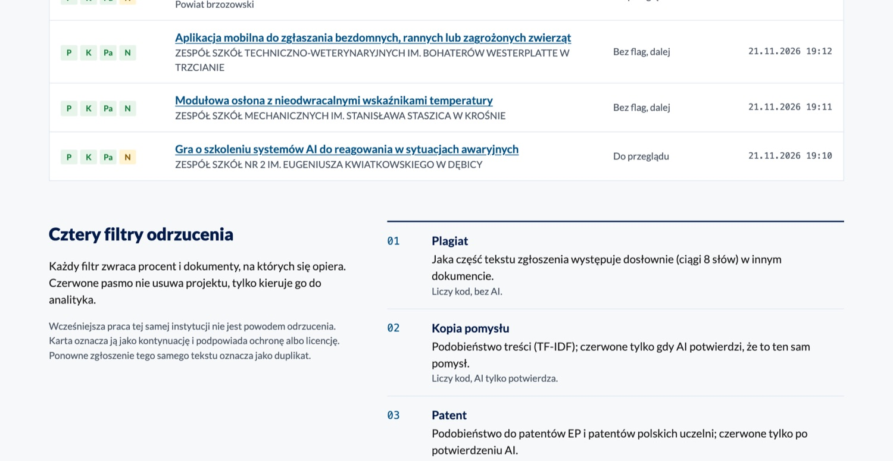

<p align="center"></p>

# Radar Innowacji

Radar, który **sam wyszukuje istniejące innowacje** na stronach szkół, uczelni i samorządów oraz w publicznych bazach
projektów i patentów, a potem **ocenia je według jawnych kryteriów**, z dowodem przy każdej liczbie.
Rozwiązanie zadania „Radar innowacji” Podkarpackiego Centrum Innowacji (HackNation 2026). PCI jest pierwszym profilem:
nowa organizacja to jeden plik JSON.

**Demo:** https://radar-innowacji.skroban.tech/ · **API:** https://radar-innowacji.skroban.tech/docs

## Dla jurorów: najważniejsze w 3 minuty

<p></p>

| Materiał | Link |
|---|---|
| Działające demo | https://radar-innowacji.skroban.tech/ |
| Film (ok. 2 min) | [docs/prezentacja/radar-innowacji-film.mp4](docs/prezentacja/radar-innowacji-film.mp4) |
| Prezentacja PDF (10 slajdów) | [docs/prezentacja/radar-innowacji.pdf](docs/prezentacja/radar-innowacji.pdf) |
| API (OpenAPI) | https://radar-innowacji.skroban.tech/docs |

**Dwa przypadki z zadania (scenariusz a–e), wszystko do kliknięcia:**

| Krok | Przypadek 1: radar sam wykrył innowację | Przypadek 2: ocena projektu z bazy |
|---|---|---|
| a) wykrycie albo wprowadzenie | wpis w aktualnościach technikum w Trzcianie, znaleziony bez zgłoszenia → [karta 7](https://radar-innowacji.skroban.tech/karta/7) | „Szukam rozwiązania”: [drony autonomiczne ładowanie](https://radar-innowacji.skroban.tech/szukaj?q=drony+autonomiczne+%C5%82adowanie) → „Oceń ten projekt” przy systemie AirNest |
| b) kluczowe informacje | [karta innowacji](https://radar-innowacji.skroban.tech/karta/7): opis, cytat ze źródła, TRL 1–3, specjalizacja ICT, wiarygodność | [karta 18](https://radar-innowacji.skroban.tech/karta/18): status wdrożenia z rejestru, TRL 6–9, wiarygodność 3/5 |
| c) ocena potencjału | 4 filtry bez flag, [potencjał 74/100](https://radar-innowacji.skroban.tech/karta/7#potencjal), każdy punkt z dowodem | 4 filtry bez flag, [potencjał 87/100](https://radar-innowacji.skroban.tech/karta/18#potencjal) |
| d) odbiorcy, partnerzy, ścieżki | komórka PCI: młodzi 16–30; ochrona (R2), bo nowość 80% i brak kolidującego patentu; podobne projekty weryfikuje analityk (patrz „Ograniczenia”) | partnerzy z podobnymi projektami dronów: Politechnika Łódzka, AGH, Łukasiewicz – Instytut Lotnictwa; ochrona (R2) i finansowanie (R4) |
| e) uzasadnienie i mierniki | miernik: zgłoszenie do UPRP albo licencja w 12 miesięcy; decyzja analityka z powodem | mierniki: zgłoszenie do UPRP albo licencja w 12 miesięcy; wniosek o finansowanie w najbliższym naborze |

Uczciwy test: [kolejka PCI](https://radar-innowacji.skroban.tech/o/pci/kolejka?wejscie=radar) pokazuje, co bramka odrzuciła automatycznie,
[karta 10](https://radar-innowacji.skroban.tech/karta/10) to błąd AI (zajęcia z maskotką) poprawiony jednym kliknięciem przez analityka,
a [miary](https://radar-innowacji.skroban.tech/miary) podają wyniki zestawu kontrolnego.

## Problem

Wartościowe pomysły ze szkół, uczelni i samorządów zostają tam, gdzie powstały. Dziś analityk szuka ich ręcznie
(bazy, strony, telefony do naukowców) i ręcznie sprawdza, czy projekt nie jest kopią, plagiatem albo czy nie jest już
opatentowany. Brakuje powtarzalnego procesu oceny z jawnymi kryteriami.

## Dla kogo

Ta sama aplikacja ma zakładki opisane językiem konkretnej osoby, z przyciskami do działającego demo (`/dla/...`):

| Zakładka | Co dostaje |
|---|---|
| [Analityk PCI](https://radar-innowacji.skroban.tech/dla/analityk) | radar sam znajduje projekty; analityk przegląda tylko karty z flagą i decyduje |
| [Szkoła i młodzi twórcy (16–30)](https://radar-innowacji.skroban.tech/dla/mlodzi) | projekt opisany w aktualnościach szkoły może zostać zauważony bez żadnego zgłoszenia |
| [Uczelnia i naukowcy](https://radar-innowacji.skroban.tech/dla/naukowcy) | czy wynik jest nowy na tle patentów i publikacji, zanim zacznie się go chronić |
| [Gmina i urząd](https://radar-innowacji.skroban.tech/dla/gmina) | które gminy wdrożyły już podobne rozwiązanie z dotacją i kogo zapytać |
| [Firma szukająca rozwiązania](https://radar-innowacji.skroban.tech/dla/firma) | kto w regionie pracuje już nad danym problemem |

## Jak działa

```text
 wejście                      wyszukiwanie (kod)                     ocena                                 człowiek
 ─────────                    ──────────────────                     ─────                                 ────────
 radar WWW ─┐                 SQLite FTS5 (BM25) po >300 tys.         bramka: 4 filtry odrzucenia           kolejka organizacji
 z bazy    ─┼─► karta ──────► dokumentów + źródła na żądanie ──────► (procent, pasmo, dowód)       ──────► decyzja z powodem
 z linku   ─┤   innowacji     (EPO, OpenAlex, Crossref) +            potencjał 0–100 (jawny wzór)          (potwierdź / przywróć /
 opis      ─┘                 wcześniej ocenione projekty            komórka, ścieżka, partnerzy           przekaż) → dziennik
```

1. **Odkrywanie.** Radar WWW co godzinę (i na żądanie, przyciskiem na stronie głównej) sprawdza 172 strony szkół, uczelni, PCI i samorządów i czyta wpisy ze 125 z nich, które mają kanał RSS lub Atom (strony bez kanału to następny krok). AI przepuszcza tylko
   wpisy, które mówią konkretnie, co zbudowano i jak działa (definicja innowacji z Oslo Manual 2018); wydarzenia, warsztaty
   i wyniki konkursów bez opisu rozwiązania odpadają. Z wpisu zostaje streszczenie bez nazwisk i dosłowny cytat-dowód.
   Bazy projektów i patentów odświeżają się co tydzień. Analityk może też ocenić projekt znaleziony w wyszukiwarce
   („Oceń ten projekt”) albo z linku lub opisu („Oceń projekt”). Radar nie jest platformą do zgłaszania pomysłów.
2. **Wyszukiwanie, filtrowanie, porównanie.** Tylko kod: indeks pełnotekstowy z wagami BM25. Opis zgłoszenia jest
   tłumaczony na angielski (DeepSeek), żeby szukać w patentach EPO i publikacjach. Wyszukiwarkę filtruje się po źródle
   i roku, katalog po werdykcie, wejściu i obszarze, a 2–4 projekty można porównać obok siebie (`/porownaj`).
3. **Bramka: cztery filtry odrzucenia.** Kryteria podali mentorzy PCI:

| Filtr | Co znaczy procent | Kto liczy | Czerwone, gdy |
|---|---|---|---|
| Plagiat | jaka część 8-wyrazowych ciągów zgłoszenia występuje dosłownie w innym dokumencie | kod | ≥ 30% |
| Kopia pomysłu | podobieństwo treści TF-IDF (rdzenie słów) | kod, AI potwierdza | ≥ 60% **i** AI: „ten sam pomysł” |
| Patent | podobieństwo do patentów EP (udzielonych i zgłoszeń) i patentów polskich uczelni | kod, AI potwierdza | ≥ 60% **i** AI: „ten sam pomysł” |
| Nowość | liczba odpowiedzi „tak” na 5 pytań rubryki | AI, kod sprawdza dowody | ≤ 1 z 5 |

   Przy każdym wyniku są linki do dokumentów, a przy plagiacie fragmenty obok siebie z podświetleniem.
   **Wcześniejsza praca tej samej instytucji nie jest powodem odrzucenia.** Jest oznaczana jako kontynuacja
   i kierowana do ochrony lub licencji. Ponowne zgłoszenie tego samego tekstu to duplikat.
4. **Ocena potencjału 0–100.** Wzór: `100 × Σ punkty / Σ maksimów kryteriów z danymi`. Wagi są w profilu organizacji.
   **Bramka nowości:** dojrzałość, zapotrzebowanie, ochronę, finansowanie i specjalizacje mnożymy przez udział punktów
   nowości. Rutynowy zakup bywa dojrzały, powszechny i sfinansowany, ale nie ma potencjału innowacji. Bez oceny nowości
   wynik nie jest liczony.

| Kryterium | Źródło | Jak liczone |
|---|---|---|
| Nowość | AI (rubryka) | „tak” w Q1–Q3 i Q5, każda odpowiedź z dokumentem-dowodem |
| Dojrzałość | formularz | pomysł 25%, prototyp 60%, zakończone 80%, wdrożone 100% |
| Mierzalna przewaga | AI (rubryka) | Q4: koszt, czas, skala |
| Zapotrzebowanie i transfer | kod | inne instytucje z podobnym (nie skopiowanym) projektem; pełne punkty od 5 |
| Możliwość ochrony | kod | wynik filtra patentowego |
| Precedens finansowania | kod | podobne projekty z dofinansowaniem (Mapa Dotacji, Interreg) |
| Specjalizacje organizacji | kod | słowa kluczowe z profilu; dla PCI: lotnictwo i kosmos, motoryzacja, ICT, jakość życia |

5. **Karta innowacji (FAQ §5).** Opis, obszar (technologiczny, edukacyjny, administracyjny), źródło z cytatem, status
   wdrożenia w 5 poziomach (koncepcja → rozwiązanie stosowane), TRL 1–9 (zakres z etapu), ocena potencjału i wiarygodność
   (5 kryteriów liczonych kodem: rejestr publiczny, link, sprawdzony cytat, dowody filtrów, dostępność źródeł). Każde pole
   ma oznaczenie: **fakt z danych**, **deklaracja**, **szacunek AI** albo **reguła w kodzie**.
6. **Dalej.** Werdykt (`odrzucone, do przeglądu` / `do przeglądu` / `bez flag`), komórka organizacji
   (PCI: młodzi 16–30, naukowcy, inni, ogólne), ścieżka z nazwaną regułą (R1 akceleracja i Protolab, R2 ochrona,
   R3 transfer, R4 finansowanie, R5 współpraca) i instytucje, które już działają w temacie.
7. **Człowiek decyduje.** Kolejka pokazuje najpierw pozycje z flagą, a w obrębie werdyktu sortuje po potencjale.
   Decyzja i jej powód trafiają do dziennika.

**Dlaczego to nie jest „AI wrapper”.** Wyszukiwanie, plagiat, podobieństwo, reguły ścieżek i wzór potencjału liczy kod.
AI (DeepSeek przez OpenRouter, temperatura 0, bez rozumowania) robi tylko to, czego nie da się zaprogramować:
tłumaczy zapytanie, potwierdza kopie, odpowiada na pytania rubryki nowości i wyciąga kartę z tekstu strony. Kod odrzuca
każdą odpowiedź, która powołuje się na dokument spoza wyników, i każdy „cytat”, którego nie ma w tekście.

## Źródła danych

| Źródło | Tryb | Zakres | Uwagi |
|---|---|---|---|
| [Mapa Dotacji UE](https://mapadotacji.gov.pl) | pobierane (API WordPress) | 265 880 projektów z całej Polski (stan na 22.11.2026) | beneficjent tylko ze strony projektu, dociągany na żądanie; filtr województwa |
| [Interreg Polska–Słowacja](https://pl-sk.eu) | pobierane (XLSX) | 258 projektów | |
| [RAD-on](https://radon.nauka.gov.pl): projekty | pobierane (API) | 48 817 projektów naukowych | bez nazwisk kierowników |
| RAD-on: patenty | pobierane (API) | 19 004 patentów i wzorów polskich uczelni | bez nazwisk twórców |
| [Biuletyn Urzędu Patentowego](https://uprp.gov.pl/pl/publikacje/biuletyn-i-wiadomosci-uprp) | pobierane (PDF, 52 ostatnie numery) | zgłoszenia wynalazków i wzorów użytkowych | bez twórców (72) i zgłaszających osób fizycznych; jawne po 18 miesiącach |
| [EPO Linked Data](https://data.epo.org/linked-data/) + European Publication Server | na żądanie | tytuły EP, zgłaszający, A/B, abstrakty 5 najlepszych | bez klucza |
| [OpenAlex](https://openalex.org) | na żądanie | publikacje z abstraktami | darmowy klucz |
| [Crossref](https://www.crossref.org) | na żądanie | metadane publikacji | |
| Radar WWW | kanały RSS | `konfiguracja/zrodla_www.csv` | robots.txt, 1 zapytanie/s na host |

Pobieranie: `python -m radar.cli pobierz mapadotacji|interreg|radon|radon_patenty|uprp` (wznawialne; `uprp` wymaga `pdftotext` z poppler-utils).
Zawsze respektujemy robots.txt, a zabezpieczeń anty-botowych nie obchodzimy. Dlatego e-Wyszukiwarka UPRP (Incapsula)
jest tylko linkowana, a wyszukiwarka CORDIS (`Disallow: /search`) pominięta.

## Warunki działania: aktualność danych, harmonogram, AI, wymagania

Na żywo: strona [/warunki](https://radar-innowacji.skroban.tech/warunki) i `GET /api/zrodla`. Każda karta innowacji
podaje stan danych, na których ją oceniono, i godzinę zapytań na żywo.

| Źródło | Tryb | Aktualizacja | Opóźnienie po stronie źródła |
|---|---|---|---|
| Mapa Dotacji UE | kopia lokalna (API) | co tydzień, pon. 03:00 | projekty pojawiają się po podpisaniu umowy |
| Interreg PL–SK | kopia lokalna (XLSX) | co miesiąc, 1. dnia 03:30 | lista publikowana przez sekretariat programu |
| RAD-on: projekty | kopia lokalna (API) | co tydzień, wt. 03:00 | wpisy uczelni i instytutów |
| RAD-on: patenty uczelni | kopia lokalna (API) | co tydzień, śr. 03:00 | tylko udzielone; zgłoszenia jawne po 18 mies. |
| EPO (patenty EP) | na żywo | przy każdym sprawdzeniu | EPO publikuje co tydzień (środa); zgłoszenia jawne po 18 mies. od pierwszeństwa |
| OpenAlex, Crossref | na żywo | przy każdym sprawdzeniu | |
| Radar WWW (RSS) | kanały RSS | co godzinę i na żądanie (przycisk „Sprawdź źródła teraz”, najwyżej raz na 10 min), wpisy z 180 dni | zależnie od tego, kiedy szkoła opublikuje wpis |

Harmonogram realizują timery systemd instalowane przez `wdrozenie/vm.sh`
(`wdrozenie/aktualizuj.sh <źródło>` → `python -m radar.cli pobierz <źródło> --od-nowa` albo `radar`).
Dane z 21.11.2026 to pierwsze pełne pobranie.

**Ścieżki AI**

| Ścieżka | Ustawienia | Wymagania i koszt | Dane |
|---|---|---|---|
| A: API w chmurze (domyślna) | `OPENROUTER_API_KEY`, `deepseek/deepseek-v4.1-flash`, temperatura 0 | ok. 0,001 $ na sprawdzenie, bez GPU | opis trafia do dostawcy; `data_collection: deny` |
| B: lokalnie, własny model | `AI_URL` (API zgodne z OpenAI: Ollama, vLLM, LM Studio), `MODEL`, opcjonalnie `AI_API_KEY` | model 7–12 mld parametrów: ok. 8–12 GB GPU albo 16 GB RAM | nic nie opuszcza serwera; jakości nie mierzyliśmy |
| C: bez AI | brak klucza | brak | działa wyszukiwanie, plagiat, podobieństwo, patenty; kopia i patent najwyżej żółte; nowość i potencjał: brak danych |

**Wymagania:** Linux albo macOS, Python 3.12+ (albo Docker), 1–2 vCPU, 4 GB RAM, 3 GB dysku (baza z całą Polską ok. 1,0 GB; demo działa na 1 vCPU i 4 GB RAM),
wyjście HTTPS do źródeł, reverse proxy z HTTPS. Klucze: `OPENROUTER_API_KEY` (ścieżka A), `OPENALEX_API_KEY`
(darmowy, opcjonalny); EPO i RAD-on bez klucza. Jedno sprawdzenie trwa 15–45 s.

## Ograniczenia (świadome)

- **Zgłoszenia patentowe są jawne dopiero po 18 miesiącach.** Karta zawsze to przypomina. Polskie zgłoszenia w toku
  bierzemy z Biuletynu UPRP (52 ostatnie numery).
- Patenty EP są wyszukiwane po tytułach. Abstrakty pobieramy dla 5 najlepszych wyników.
- Podobieństwo TF-IDF łapie przepisany tekst, ale nie ten sam pomysł opisany zupełnie innymi słowami. Dlatego czerwone
  pasmo kopii wymaga potwierdzenia AI, a nowość ocenia rubryka.
- W drugą stronę też się myli: aplikacja do zgłaszania bezdomnych zwierząt (karta 7) dostała jako „podobne” projekty
  o osobach w kryzysie bezdomności. Dlatego listę partnerów i ścieżkę finansowania traktujemy jako podpowiedź,
  którą zatwierdza analityk.
- Wagi potencjału i progi są eksperckie. Dziennik decyzji analityków służy do ich kalibracji.
- Jedno sprawdzenie ma limit 150 s: źródło albo dostawca AI, który nie odpowiada, zostaje pominięty, a karta mówi, co
  pominięto.
- Wersja demo jest publiczna, bez logowania; decyzje może wpisać każdy. Limit: 20 sprawdzeń na adres IP na godzinę
  i 200 na dobę.

## Miary

Zestaw testowy (`python -m radar.cli zestaw`, na osobnej kopii bazy) buduje przypadki ze znaną prawdą z dzisiejszych
danych: plagiat dwóch projektów, parafrazę AI, przepisany patent, własną pracę i duplikat. Wyniki: `walidacja/raport.md`
i strona `/miary`.

| Przypadek (21.11.2026, 52 sprawdzenia) | Wykryte |
|---|---|
| Plagiat (połowa zdań z dwóch projektów) | 9/9 |
| Kopia (projekt przepisany przez AI) | 10/10 |
| Patent (opis patentu uczelni przepisany) | 5/5 |
| Własna praca: kontynuacja, bez odrzucenia | 5/5 |
| Duplikat zgłoszenia | 3/3 |

Mediana czasu sprawdzenia 44 s (4 równolegle), średni koszt AI 0,0013 $. Zestaw mierzy czułość na przypadkach
zbudowanych, a nie odsetek fałszywych alarmów.

**Nowość na prawdziwych projektach.** 20 projektów z Mapy Dotacji (10 rutynowych zakupów i inwestycji, 10 wdrożeń i B+R).
Etykiety „rutyna / nowość” nadało głosowanie 5 niezależnych modeli: GPT-5.4-mini, Gemini 3.8 Flash, Claude Haiku 5.5,
Mistral Small (przez OpenRouter) i Antigravity. Nie głosował DeepSeek, który ocenia w radarze. 19 z 20 etykiet jest
jednogłośnych (`walidacja/etykiety_glosy.csv`); to nie jest ocena człowieka.

Pierwszy pomiar pokazał, że filtr nowości był za surowy dla wdrożeń firm (czerwony w 6 z 9). Poprawiliśmy rubrykę:
pytanie o rutynę bez podwójnego przeczenia, „brak nowości” tylko wtedy, gdy dokument opisuje to samo rozwiązanie,
a własne nowe rozwiązanie najwyżej żółte (Oslo 2018: nowe dla instytucji to też innowacja). Potem rubrykę zamroziliśmy
i zmierzyliśmy ją na zestawie kontrolnym.

| Miara | Pierwszy pomiar (20 projektów) | Obecna wersja (te same 20) | Zestaw kontrolny (50 nowych) |
|---|---|---|---|
| Zgodność koloru nowości z etykietami (żółte i zielone = nowość) | 0,56 (n=16) | 0,95 (n=19) | **0,62 (n=48)** |
| Średni potencjał: nowość / rutyna | 28 / 18 pkt | 59,8 / 10,5 pkt | **66,8 / 22,0 pkt** |
| Potencjał nowości wyżej niż rutyny (AUC, bez progu) | – | 0,93 | **0,89** |
| Nowości odrzucone przez lejek | – | 2 z 10 | **2 z 20** |
| Rutyny zatrzymane (odrzucone lub do przeglądu) | – | 10 z 10 | **29 z 30** |

Niezależny jest tylko zestaw kontrolny: 50 projektów Mapy Dotacji wylosowanych po zamrożeniu rubryki (30 losowych
i 20 losowych ze słowami B+R, innowacja, technologia), z pominięciem projektów użytych wcześniej. Etykiety pochodzą
z tego samego głosowania 5 modeli (39 z 50 jednogłośnych, `walidacja/kontrolne_glosy.csv`). Rubryki po tym pomiarze
nie zmienialiśmy. Spadek z 0,95 do 0,62 pokazuje, ile dało dopasowanie do 20 projektów, na których poprawialiśmy rubrykę.

Wniosek z zestawu kontrolnego: ranking potencjału działa (losowa nowość ma wyższy potencjał niż losowa rutyna w 89%
par), a lejek rzadko odrzuca prawdziwą nowość (2 z 20). Słaby jest sam kolor nowości: 15 z 30 rutyn dostaje żółte
„do sprawdzenia”, bo model w pytaniu Q5 uznaje je za własne rozwiązanie, a nie rutynę (8 z nich podniosła
reguła Oslo, 7 próg dwóch odpowiedzi „tak”). To błąd w bezpieczną stronę: więcej przeglądu,
mniej utraconych innowacji. Następną poprawkę zmierzymy na nowym zestawie kontrolnym, a docelowo na etykietach
analityków PCI. Każde odrzucenie przegląda człowiek. Opisy projektów OSP często dzielą szablonowe zdania, więc filtr
plagiatu flaguje je do przeglądu.

## Uruchomienie

```bash
uv venv && uv pip install -r requirements.txt pytest      # albo: python -m venv .venv && pip install -r requirements.txt
cp .env.example .env                                       # wpisz OPENROUTER_API_KEY i OPENALEX_API_KEY
python -m radar.cli pobierz interreg                       # i pozostałe źródła
uvicorn radar.app:app --port 8090                          # http://127.0.0.1:8090
python -m radar.cli sprawdz --opis "…" --organizacja pci   # sprawdzenie z wiersza poleceń
python -m radar.cli radar --limit 300                      # radar WWW
pytest                                                     # testy (te z prawdziwym API pomijane bez kluczy)
```

Wdrożenie na Ubuntu: `wdrozenie/vm.sh` (uvicorn jako usługa systemd, Caddy z HTTPS, osobny blok hosta).
Docker: `docker build -t radar-innowacji . && docker run -p 8090:8090 -v "$PWD/dane:/app/dane" --env-file .env radar-innowacji`.

## Integracja i skalowanie

- REST API z OpenAPI: `POST /api/zgloszenia`, `GET /api/karta/{id}`, `GET /api/zgloszenia`, `GET /api/szukaj?q=&zrodlo=&rok_od=`,
  `GET /api/miary`, `GET /api/organizacje`.
- Nowa organizacja (inkubator, centrum transferu technologii uczelni, samorząd): plik `konfiguracja/organizacje/<slug>.json`
  z komórkami, ścieżkami, wagami potencjału i specjalizacjami. Kolejka pod `/o/<slug>/kolejka`.
- Nowe województwo: parametr `--woj` przy Mapie Dotacji i nowa lista `zrodla_www.csv`.
- Bezpieczeństwo: klucze tylko w `.env`, escapowanie całego tekstu z zewnątrz, linki tylko http(s), ochrona przed SSRF
  przy pobieraniu strony z linku, XML z encjami odrzucany, brak danych osobowych z baz (bez nazwisk twórców i kierowników).

## Dalszy rozwój

- Logowanie i role analityków (dziś demo jest publiczne, z limitem sprawdzeń na IP).
- Kalibracja wag potencjału i progów filtrów na decyzjach analityków z dziennika, mierzona na nowym zestawie kontrolnym.
- Powiadomienia dla komórek PCI o nowych kartach bez flag.
- Kolejne źródła: PBN (wymaga tokenu), zrzuty CORDIS, więcej stron szkół i gmin w `konfiguracja/zrodla_www.csv`.

## Zasoby zewnętrzne i licencje

- Dane publiczne: Mapa Dotacji UE, Interreg Polska–Słowacja, RAD-on, Biuletyn UPRP, EPO (Linked Data i European Publication Server),
  OpenAlex, Crossref, kanały RSS stron szkół, uczelni i instytucji (lista w `konfiguracja/zrodla_www.csv`).
- Model AI: DeepSeek przez OpenRouter (ścieżka A); etykiety zestawu kontrolnego: głosowanie 5 modeli (opis w sekcji „Miary”).
- Font Lato (Łukasz Dziedzic), licencja SIL Open Font License 1.1, pliki w `radar/static/fonts` razem z `OFL.txt`.
- Biblioteki Pythona z `requirements.txt` (MIT, BSD lub Apache-2.0).

## Autorzy

Karol Skroban. Projekt, plan i dziennik decyzji: `docs/`.

## Licencja

EUPL-1.2. Zależności: MIT, BSD lub Apache-2.0.
