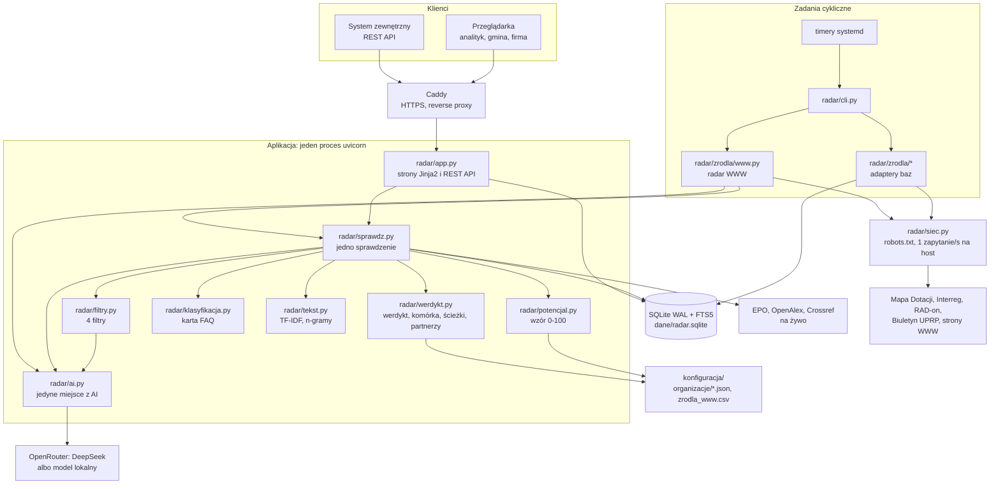
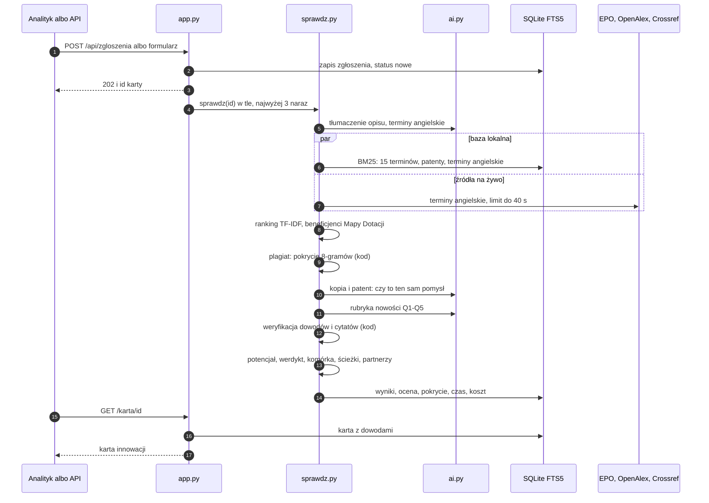
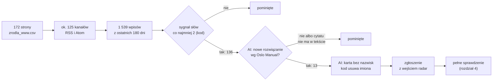
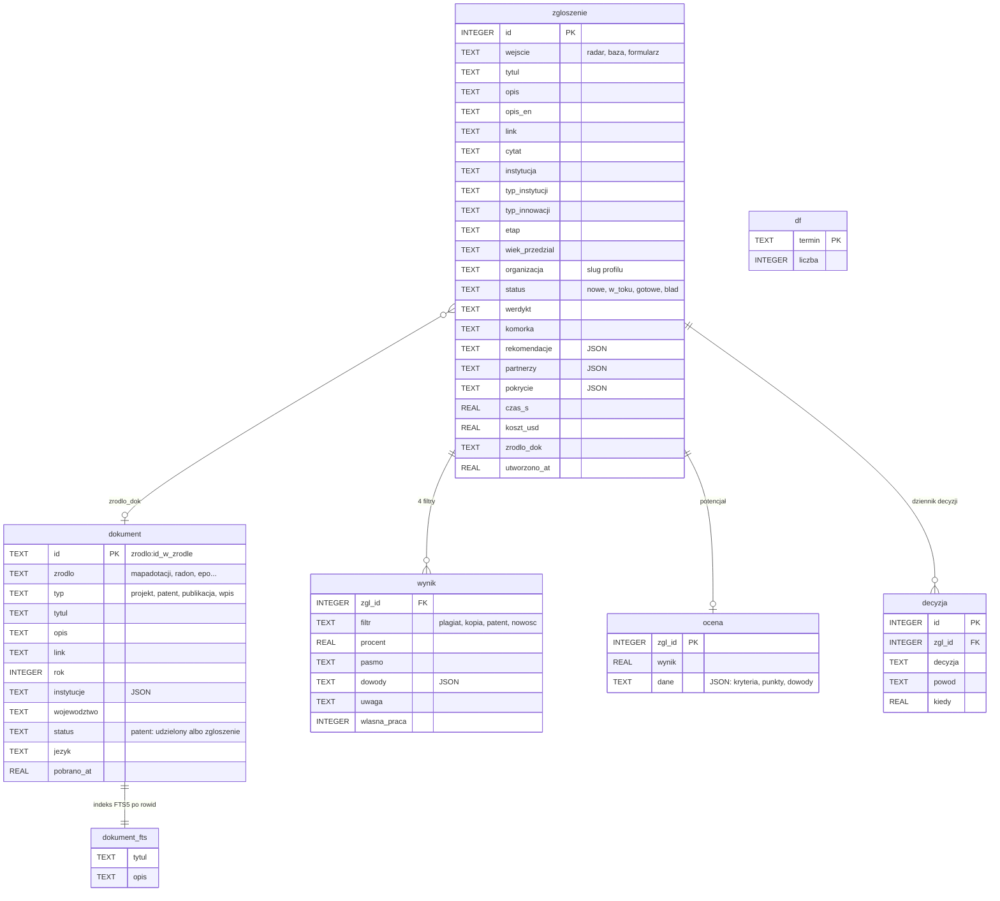
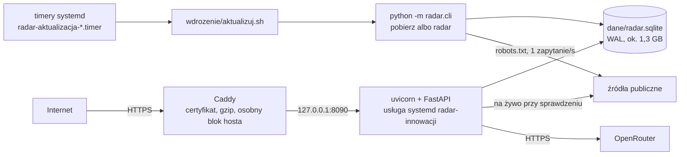

# Architektura: jak Radar Innowacji działa technicznie

Ten dokument opisuje budowę systemu: komponenty, przepływ jednego sprawdzenia, radar WWW, wyszukiwanie i miary
podobieństwa, granice AI, model danych, wdrożenie i bezpieczeństwo. Reguły oceny (progi, wzór, ścieżki) i dane
z opóźnieniami opisuje [SPECYFIKACJA.md](SPECYFIKACJA.md).

## Spis treści

1. [Zasady projektu](#1-zasady-projektu)
2. [Komponenty](#2-komponenty)
3. [Moduły](#3-moduły)
4. [Przepływ jednego sprawdzenia](#4-przepływ-jednego-sprawdzenia)
5. [Radar WWW: od kanału RSS do karty](#5-radar-www-od-kanału-rss-do-karty)
6. [Wyszukiwanie i miary podobieństwa](#6-wyszukiwanie-i-miary-podobieństwa)
7. [Granice AI](#7-granice-ai)
8. [Model danych](#8-model-danych)
9. [Konfiguracja](#9-konfiguracja)
10. [Wdrożenie i harmonogram](#10-wdrożenie-i-harmonogram)
11. [Bezpieczeństwo i prywatność](#11-bezpieczeństwo-i-prywatność)
12. [Testy i jakość](#12-testy-i-jakość)
13. [Jak rozszerzyć system](#13-jak-rozszerzyć-system)

---

## 1. Zasady projektu

1. **Kod liczy, AI potwierdza.** Wyszukiwanie, plagiat, podobieństwo, reguły ścieżek i wzór potencjału to deterministyczny
   kod. AI (DeepSeek przez OpenRouter, temperatura 0, bez rozumowania) robi tylko to, czego nie da się zaprogramować:
   tłumaczy zapytanie, potwierdza „ten sam pomysł”, odpowiada na pytania rubryki nowości i wyciąga kartę z tekstu strony.
2. **Dowód przy każdej liczbie.** Każdy filtr zwraca dokumenty z linkami, każda rekomendacja nazwę reguły, każde pole
   karty pochodzenie (fakt, deklaracja, szacunek AI, reguła w kodzie).
3. **Człowiek decyduje.** System flaguje i uzasadnia. Odrzucenie automatyczne zawsze trafia do przeglądu.
4. **Konfiguracja zamiast kodu.** Organizacja (komórki, ścieżki, wagi, specjalizacje) to plik JSON, lista stron radaru
   to plik CSV, progi są w jednym miejscu (`radar/config.py`).
5. **Mało ruchomych części.** Jeden proces Pythona (FastAPI), jedna baza SQLite z indeksem pełnotekstowym, timery
   systemd. Bez kolejek, kontenerów pośrednich i baz wektorowych: całość działa na serwerze z 1 vCPU i 4 GB RAM.

## 2. Komponenty

## 3. Moduły

| Moduł | Odpowiedzialność | Wejście → wyjście |
|---|---|---|
| `radar/app.py` | strony WWW (Jinja2), REST API (OpenAPI), limity na IP, kolejka sprawdzeń w tle (najwyżej 3 naraz) | żądanie HTTP → HTML albo JSON |
| `radar/sprawdz.py` | orkiestracja jednego sprawdzenia: wyszukiwanie, źródła na żywo, filtry, potencjał, werdykt, pokrycie | id zgłoszenia → karta |
| `radar/filtry.py` | plagiat, kopia, patent, nowość; reguła własnej pracy i duplikatu | zgłoszenie + kandydaci → 4 × `WynikFiltra` |
| `radar/potencjal.py` | potencjał 0–100 z jawnego wzoru, bramka nowości, przeliczanie zapisanych ocen | wyniki filtrów + ranking + profil → ocena z kryteriami |
| `radar/werdykt.py` | werdykt, komórka, ścieżki R1–R5, partnerzy | wyniki + podobne + profil → rekomendacje |
| `radar/klasyfikacja.py` | karta wg FAQ PCI §5: obszar, status wdrożenia, TRL, wiarygodność, zasięg, pochodzenie pól | karta → pola z pochodzeniem |
| `radar/ai.py` | jedyne miejsce z AI; każda funkcja zwraca (wynik, koszt w USD); weryfikacja cytatów i identyfikatorów dokumentów | tekst → JSON |
| `radar/tekst.py` | normalizacja, słowa nieznaczące, rdzenie, TF-IDF, podobieństwo cosinusowe, pokrycie 8-gramów, wspólne fragmenty | tekst → wektory, miary |
| `radar/db.py` | schemat, FTS5/BM25, statystyki df, zgłoszenia, wyniki, oceny, decyzje, stan źródeł | SQL |
| `radar/instytucje.py` | normalizacja nazw instytucji; reguła „ta sama instytucja” (własna praca) | nazwy → tak/nie |
| `radar/organizacje.py` | wczytywanie profili organizacji | slug → profil |
| `radar/termin.py` | budżet czasu sprawdzenia (150 s) i notatki o pominiętych krokach | – |
| `radar/siec.py` | grzeczne pobieranie: robots.txt per host, 1 zapytanie/s na host, User-Agent, ponowienia, blokada adresów prywatnych | URL → odpowiedź |
| `radar/slowniki.py` | słowniki pól, decyzje, mierniki ścieżek, harmonogram źródeł, role, czas polski | – |
| `radar/walidacja.py` | zestaw testowy i kontrolny, raport miar | baza → `walidacja/raport.md` |
| `radar/cli.py` | `pobierz`, `radar`, `sprawdz`, `zestaw`, `kontrolny`, `raport`, `przelicz` | – |
| `radar/zrodla/` | adaptery: `mapadotacji` (API WordPress), `interreg` (XLSX), `radon` i `radon_patenty` (API), `uprp` (PDF Biuletynu), `epo` (SPARQL Linked Data i European Publication Server), `openalex`, `crossref`, `www` (RSS/Atom) | źródło → `list[Dokument]` |

## 4. Przepływ jednego sprawdzenia

Krok po kroku (`radar/sprawdz.py: sprawdz`):

1. **Tłumaczenie.** AI tłumaczy opis na angielski i podaje 5–10 angielskich terminów (patenty EP i publikacje są po angielsku).
2. **Kandydaci z bazy lokalnej.** 15 terminów o najwyższej wadze TF-IDF z tytułu i opisu → BM25: 50 dokumentów dowolnego
   typu, 20 patentów, 20 dla terminów angielskich.
3. **Źródła na żywo.** EPO, OpenAlex i Crossref równolegle. Źródło, które nie odpowie w budżecie, jest pomijane i zapisane
   w pokryciu karty. Pobrane dokumenty trafiają do bazy (pamięć podręczna dowodów).
4. **Ranking.** Podobieństwo cosinusowe TF-IDF zgłoszenia do każdego kandydata. Dokument źródłowy projektu z bazy jest
   wykluczony: to ten sam projekt, nie dowód przeciwko niemu.
5. **Beneficjenci.** Mapa Dotacji podaje beneficjenta tylko na stronie projektu; dla najbliższych (do 5) jest dociągany,
   bo od niego zależy reguła własnej pracy.
6. **Filtry.** Plagiat i kopia porównują też z wcześniejszymi zgłoszeniami (duplikaty), patent tylko z patentami,
   nowość z 10 najbliższymi dokumentami innych instytucji.
7. **Potencjał, werdykt, komórka, ścieżki, partnerzy** według profilu organizacji.
8. **Zapis** wyników, oceny i pokrycia: źródła, liczby dokumentów, stan danych, godzina zapytań na żywo, użyte modele AI,
   pominięte kroki, czas i koszt.

**Budżet czasu** (`radar/termin.py`, `LIMIT_SPRAWDZENIA_S = 150`): źródła na żywo dostają najwyżej 40 s i zostawiają
minutę na filtry i AI; beneficjenci najwyżej 30 s i zostawiają 75 s; zapytanie do AI nie rusza, gdy zostało mniej niż 8 s.
Karta zawsze powstaje, a pominięte kroki są na niej opisane.

## 5. Radar WWW: od kanału RSS do karty

- **Sygnał słów (kod):** +2 za „zbudował”, „skonstruował”, „zaprojektował”, „stworzył”, „opracował”, „wynalazek”, „prototyp”,
  „aplikacja”, „robot”, „patent”, „innowacja”, „autorski”, „startup”; +1 za „laureat”, „nagroda”, „finalista”, „grant”;
  −3 za „jadłospis”, „wycieczka”, „akademia z okazji…”, „rekolekcje”, „zebranie”, „dyżur”. Próg 2.
- **Bezpiecznik kosztu:** najwyżej 150 wpisów do AI na przebieg (ok. 0,05 $).
- **AI z cytatem:** odpowiedź „tak” tylko wtedy, gdy tekst mówi konkretnie, co zbudowano i jak działa; wydarzenia,
  warsztaty, konkursy, zakupy, remonty i kampanie odpadają. Kod sprawdza, że cytat jest dosłownie w tekście.
- **Bez danych osobowych:** AI ma zakaz podawania imion i nazwisk, a kod usuwa imiona z listy imion polskich
  (uczniowie bywają niepełnoletni).
- **Jeden przebieg naraz:** blokada pliku (`fcntl.flock`) chroni przed równoległym timerem i przyciskiem.
  Przycisk „Sprawdź źródła teraz” działa najwyżej raz na 10 minut od końca poprzedniego przebiegu.
- **Typ instytucji z listy:** uczelnia → uczelnia; szkoła → szkoła ponadpodstawowa (twórcy 16–30); samorząd → JST;
  instytucja → inna publiczna. Od tego zależy komórka.

## 6. Wyszukiwanie i miary podobieństwa

| Etap | Technika | Szczegóły |
|---|---|---|
| Indeks | SQLite FTS5 | kolumny `tytul`, `opis`; tokenizer `unicode61 remove_diacritics 2` (wyszukiwanie bez polskich znaków) |
| Zapytanie | BM25 | rdzenie terminów z dopasowaniem prefiksowym (`"rdzen"*`, łączone OR); waga tytułu 3, opisu 1; filtry typu, źródła, roku i województwa w SQL |
| Wybór terminów | TF-IDF | 15 terminów zgłoszenia o najwyższym TF × IDF; IDF z tabeli `df` liczonej dla całego korpusu |
| Rdzenie | obcięcie do 6 znaków | słowo po normalizacji (małe litery, bez polskich znaków) skrócone do 6 pierwszych liter, np. „aplikacja”, „aplikacji” → „aplika”; lista słów nieznaczących (`radar/tekst.py`) |
| Kopia, patent, ranking | cosinus TF-IDF | wektory rdzeni ważone IDF; wynik 0–1 (na karcie w procentach) |
| Plagiat | pokrycie 8-gramów | udział 8-wyrazowych ciągów zgłoszenia obecnych w dokumencie; scalanie sąsiednich trafień w fragmenty do podświetlenia |
| „Szukam rozwiązania” | BM25 + cosinus | bez AI; zgłoszenia sortowane po podobieństwie |

Dlaczego bez wektorów semantycznych (embeddingów): BM25 i TF-IDF są wyjaśnialne (widać wspólne słowa i fragmenty), działają
bez GPU i bez wysyłania korpusu do dostawcy, a słabość, czyli ten sam pomysł innymi słowami, pokrywa rubryka nowości
i potwierdzenie AI na krótkiej liście kandydatów.

## 7. Granice AI

| Funkcja (`radar/ai.py`) | Kiedy | Wejście | Wyjście | Co sprawdza kod |
|---|---|---|---|---|
| `tlumacz_zapytanie` | każde sprawdzenie | opis | opis po angielsku, 5–10 terminów, podklasy IPC | brak terminów → źródła na żywo pominięte i opisane |
| `ten_sam_pomysl` | kopia i patent, gdy podobieństwo przekracza próg | opis + najbliższe dokumenty | ten sam / częściowo / inny, z uzasadnieniem | identyfikator musi być z listy kandydatów; czerwone pasmo tylko z potwierdzeniem |
| `rubryka_nowosci` | każde sprawdzenie | opis + 10 najbliższych dokumentów innych instytucji | Q1–Q5: tak / nie / nie wiadomo, dokument-dowód, uzasadnienie | dowód spoza wyników odrzucany; mniej niż 3 odpowiedzi → brak danych; pasmo i punkty liczy kod |
| `czy_innowacja` | radar WWW | tytuł i tekst wpisu | tak / nie / niepewne + dosłowny cytat | cytat musi być w tekście |
| `karta_z_tekstu` | radar WWW, ocena z linku | tytuł i tekst strony | nazwa, opis, instytucja, typ, etap, cytat (bez nazwisk) | cytat musi być w tekście; wartości typów i etapów tylko ze słownika |
| `parafrazuj` | tylko zestaw testowy | opis projektu | przepisany tekst (przypadek „kopia”) | – |

**Niezawodność i koszt.** Każda odpowiedź to JSON. Do 3 prób: każde ponowienie omija dostawcę OpenRouter, który zawiódł
(pusta treść, ucięta odpowiedź), a ostatnia idzie do modelu zapasowego innej rodziny (`MODEL_ZAPASOWY`). Karta zapisuje,
które modele i którzy dostawcy odpowiedzieli. Każda funkcja zwraca koszt; suma trafia na kartę (`koszt_usd`).

**Ścieżki AI** (`.env`):

| Ścieżka | Ustawienia | Dane |
|---|---|---|
| A: API w chmurze (domyślna) | `OPENROUTER_API_KEY`, `MODEL=deepseek/deepseek-v4.1-flash` (wersja przypięta), temperatura 0 | opis i fragmenty dokumentów trafiają do dostawcy; `data_collection: deny` |
| B: lokalnie | `AI_URL` (API zgodne z OpenAI: Ollama, vLLM, LM Studio), `MODEL`, opcjonalnie `AI_API_KEY` | nic nie opuszcza serwera |
| C: bez AI | brak klucza | kod liczy plagiat, podobieństwo i patenty; kopia i patent najwyżej żółte; nowość i potencjał: brak danych |

## 8. Model danych

- **`dokument`** to cały korpus: kopie lokalne baz i dokumenty pobrane na żywo (pamięć podręczna dowodów).
  Identyfikator ma postać `<źródło>:<id w źródle>`, więc ponowne pobranie nadpisuje rekord w miejscu.
- **`df`** to liczba dokumentów z danym rdzeniem: z niej liczony jest IDF dla TF-IDF.
- **`zgloszenie`** to karta. Pola wynikowe (werdykt, komórka, rekomendacje, partnerzy, pokrycie) są zapisywane
  po sprawdzeniu, a `ocena.dane` przechowuje punkty każdego kryterium, więc zmiana wzoru nie wymaga ponownego
  sprawdzenia (`python -m radar.cli przelicz`).
- **`decyzja`** to dziennik analityka. Nie nadpisuje wyniku filtrów, tylko leży obok niego, żeby dało się mierzyć
  zgodność i kalibrować progi.
- Tryb WAL: aplikacja czyta w czasie, gdy timer odświeża źródło.

## 9. Konfiguracja

| Plik | Zawartość |
|---|---|
| `konfiguracja/organizacje/<slug>.json` | profil organizacji: komórki z warunkami, nazwy ścieżek R1–R5, wagi potencjału, specjalizacje ze słowami kluczowymi (przykład w specyfikacji, rozdział 7.4) |
| `konfiguracja/zrodla_www.csv` | lista stron radaru: `nazwa,typ,url,kanal` (typ: uczelnia, szkoła, JST, instytucja; kanał RSS opcjonalny) |
| `radar/config.py` | progi pasm, limit czasu sprawdzenia, model AI, User-Agent |
| `.env` (poza gitem, wzór w `.env.example`) | `OPENROUTER_API_KEY`, `OPENALEX_API_KEY`, opcjonalnie `MODEL`, `AI_URL`, `AI_API_KEY`, `RADAR_BAZA` |

## 10. Wdrożenie i harmonogram

`wdrozenie/vm.sh` (Ubuntu 24.04) instaluje środowisko Pythona, usługę `radar-innowacji` (uvicorn na 127.0.0.1:8090 za Caddy,
z restartem po awarii), blok hosta w Caddy (nie zmienia innych stron na maszynie) i timery:

| Timer | Kiedy | Polecenie |
|---|---|---|
| `radar-aktualizacja-radar` | co godzinę, 5 minut po pełnej | `radar.cli radar --limit 300 --dni 180` |
| `radar-aktualizacja-mapadotacji` | poniedziałek 03:00 | `radar.cli pobierz mapadotacji --od-nowa` |
| `radar-aktualizacja-radon` | wtorek 03:00 | `radar.cli pobierz radon --od-nowa` |
| `radar-aktualizacja-radon_patenty` | środa 03:00 | `radar.cli pobierz radon_patenty --od-nowa` |
| `radar-aktualizacja-uprp` | czwartek 03:00 | `radar.cli pobierz uprp` (52 ostatnie numery Biuletynu) |
| `radar-aktualizacja-interreg` | 1. dnia miesiąca 03:30 | `radar.cli pobierz interreg --od-nowa` |

Logi aktualizacji: `dane/logi/aktualizacja-<źródło>.log`. Alternatywa: obraz Docker (`Dockerfile`) z katalogiem `dane/`
jako wolumenem i kluczami z `--env-file .env`.

**Wymagania:** Linux albo macOS, Python 3.12+, 1–2 vCPU, 4 GB RAM, 3 GB dysku, `pdftotext` (poppler-utils) dla UPRP,
wyjście HTTPS do źródeł.

## 11. Bezpieczeństwo i prywatność

| Zagrożenie | Ochrona |
|---|---|
| wyciek kluczy | klucze tylko w `.env` (poza gitem, prawa 600 na serwerze); nigdy w HTML ani w logach |
| XSS z treści zewnętrznych | autoescape Jinja2 dla całego tekstu z zewnątrz; linki tylko http(s) |
| SSRF przy „Oceń z linku” | tylko http(s), blokada adresów prywatnych i lokalnych po rozwiązaniu nazwy |
| XML bomb w kanałach RSS | dokumenty z deklaracjami encji odrzucane |
| nadużycie publicznego demo | 20 sprawdzeń na adres IP na godzinę, 200 na dobę dla całego demo, 3 sprawdzenia równolegle, radar na żądanie najwyżej raz na 10 minut |
| koszt AI | bezpiecznik radaru (150 wpisów na przebieg); koszt każdej karty zapisany |
| dane osobowe | bez nazwisk z baz i stron; AI z zakazem podawania imion i nazwisk; kod usuwa imiona; dostawca z `data_collection: deny`; ścieżka B lokalnie |
| zasady źródeł | robots.txt, 1 zapytanie/s na host, identyfikujący User-Agent; zabezpieczeń anty-botowych nie obchodzimy |

## 12. Testy i jakość

- **188 testów pytest** w `testy/` (filtry, potencjał, werdykt, karta, tekst, baza, źródła, radar WWW, API, strony, limit czasu).
  Testy z prawdziwym API są pomijane bez kluczy.
- **Zestaw testowy i kontrolny** (`radar/walidacja.py`, `walidacja/`): przypadki ze znaną prawdą i 50 projektów
  wylosowanych po zamrożeniu rubryki; wyniki na stronie `/miary` (specyfikacja, rozdział 9).
- **Przeliczanie bez kosztu:** zmiana wzoru potencjału działa na zapisanych punktach (`radar.cli przelicz`).

## 13. Jak rozszerzyć system

| Chcę dodać | Co zrobić |
|---|---|
| nową organizację | plik `konfiguracja/organizacje/<slug>.json`; kolejka od razu pod `/o/<slug>/kolejka` |
| nowe strony do radaru | wiersze w `konfiguracja/zrodla_www.csv` |
| nową bazę danych | adapter w `radar/zrodla/<nazwa>.py`, który zwraca `list[Dokument]`; wpis w `HARMONOGRAM` (`radar/slowniki.py`), timer w `wdrozenie/vm.sh`, test w `testy/` |
| nowe źródło na żywo | funkcja `szukaj(terminy_en) -> list[Dokument]` dopisana do `ZRODLA_NA_ZADANIE` w `radar/sprawdz.py` |
| nowe kryterium potencjału | funkcja w `radar/potencjal.py` dopisana do `KRYTERIA` i waga w profilu |
| nową ścieżkę | reguła w `radar/werdykt.py: sciezka`, nazwa w profilu, miernik w `MIERNIKI` |
| inny model AI | `MODEL` w `.env` albo `AI_URL` dla modelu lokalnego |
